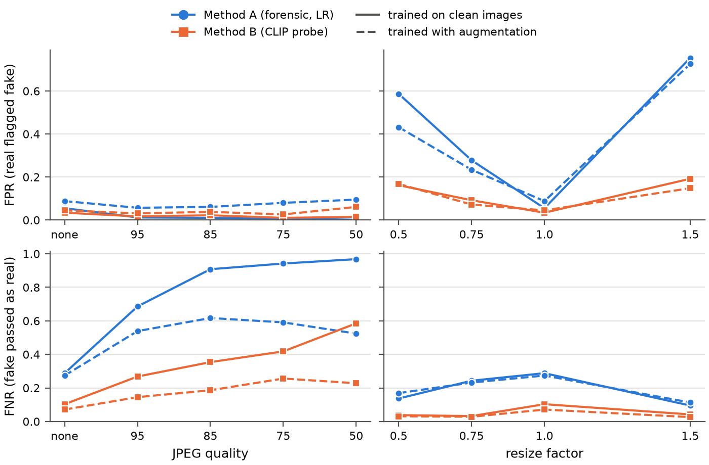
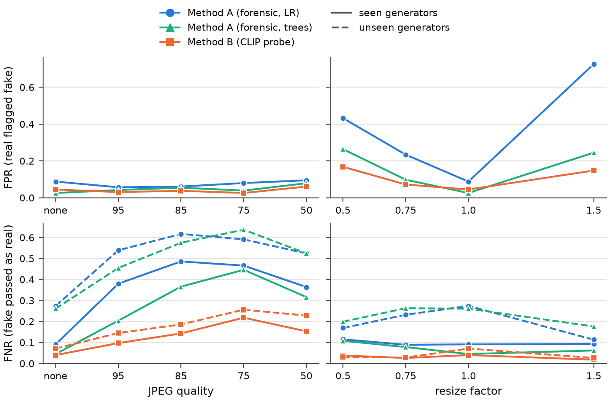
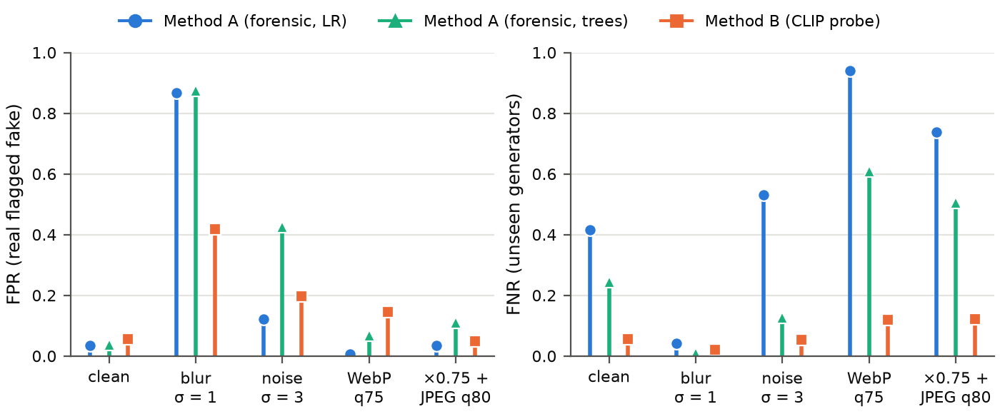

# Results log

Running log of experiments and findings. Every number here comes from a run in this repository;
the tables next to this file are exported from `runs/` with
`uv run python -m dorian_gray.experiments.export`. Label convention: 1 = fake (positive class).
FPR = real images flagged as fake, FNR = fake images passed as real. Sections 1–5 use the fixed
decision threshold 0.5; from section 6 on, results are also reported at the threshold that flags 5 %
of the *validation* reals (`val_fpr5`). Neither is tuned on test data. `summary.csv` files of runs
from 30. 10. 2026 on have a `threshold` column with both.

| Folder | Content |
|---|---|
| `method_b/` | Method B, 5 split seeds: `summary.csv` (mean, std), `summary_per_seed.csv`, per seed `metrics.json`, `per_architecture.csv`, `per_format.csv` |
| `method_a/` | Method A, same layout as `method_b/`, plus `coefficients.csv` per seed |
| `method_a_<groups>/` | Method A trained on a subset of feature groups (ablation) |
| `robustness_a/` | Method A under JPEG recompression and resizing, same layout as `robustness_b/` |
| `robustness_b/` | Method B under JPEG recompression and resizing: `metrics.csv`, `flagged_by_format.csv` |
| `method_a_aug/`, `method_b_aug/`, `robustness_a_aug/`, `robustness_b_aug/` | Same experiments with training-time augmentation (section 4) |
| `method_a_gbt/`, `method_a_gbt_aug/`, `robustness_a_gbt/`, `robustness_a_gbt_aug/` | Method A with gradient-boosted trees instead of logistic regression (section 5) |
| `external_ntire2026_val/`, `external_ntire2026_test/`, `external_aigi_now_pixel/` | Independent test sets (sections 10–11): metrics per subset and threshold, flag rate per format |
| `mixed_ntire2026_train_aug/`, `mixed_ntire2026_train_nocf/` | Training with NTIRE data added (section 12): metrics per method, seed, test set and subset |
| `method_a_norm-jpeg75/`, `method_a_gbt_norm-jpeg75/`, `method_b_norm-jpeg75/` | Every image re-encoded as JPEG q75 before feature extraction (section 9) |
| `explain_method_a/`, `explain_method_a_gbt_aug/` | Per-group and per-feature contributions to the log-odds per image group (section 7) |
| `figures/` | `robustness.pdf/.png` (A vs. B), `robustness_augmentation.pdf/.png` (clean vs. augmented training), `robustness_classifier.pdf/.png` (A linear vs. A trees vs. B, augmented training), `robustness_unseen_ops.pdf/.png` (operations not used in training, section 8) |

---

## 1. Data (29. 10. 2026)

**Community Forensics** (Park & Owens, CVPR 2025), `OwensLab/CommunityForensics-Small`, CC BY-NC-SA.

- The "Small" repository is ~260 GB in 186 parquet shards (not 5.7 GB as the dataset viewer
  suggests). Each shard is one row group whose image column is a single uncompressed page, so a shard
  cannot be read partially: peak RAM is about the shard size (up to ~4.6 GB). We therefore built a
  metadata manifest of all shards (read remotely, metadata columns only) and downloaded 33 selected
  shards (31 GB).
- Seeded sample: 2,000 images per real shard, 1,000 per fake shard → **42,000 images**:

| | JPEG | PNG | Total |
|---|---|---|---|
| Real | 8,000 | 10,000 | 18,000 |
| Fake | 2,077 | 21,923 | 24,000 |

| Fake architecture | Images | Generators |
|---|---|---|
| GAN | 12,126 | 12 |
| Latent diffusion | 7,344 | 311 |
| Pixel diffusion | 2,453 | 3 |
| Other | 2,077 | 1 |

- **Split protocol** (`experiments/classify.py`): real images random 70/10/20 % (train/val/test);
  30 % of the fake *generators* are held out entirely ("unseen" test), the images of the remaining
  generators are split 70/10/20 % ("seen" test). Unseen results pair the held-out fakes with the
  same real test images, so FPR is identical in both test sets.
- The holdout is 30 % of generators *by count* (98 of 327). Since 311 generators are latent-diffusion
  fine-tunes, while GANs are few but large, the number of unseen images varies a lot between seeds
  (4,259 to 10,068), and so does the difficulty of the unseen set. Results are therefore reported as
  mean ± std over 5 seeds.

**Data caveats**
- File names repeat within a shard (different generators reuse names such as `00000152.png`); images
  are keyed by `(shard, row)`. Found by the 1:1 merge check; all 33 caches were verified name by name
  against the manifest.
- All 2,077 JPEG fakes come from **one generator (LFM)**. In the clean test, file format and
  generator are therefore confounded (see 2.3).

## 2. Method B: frozen CLIP ViT-L/14 + logistic regression (UnivFD-style)

Setup: open_clip `ViT-L-14/openai`, visual tower only, fp16 on a GTX 1050 (0.83 GB VRAM, ~7 img/s);
center crop 224 (no downscaling; upscale only below 224 px); 768-d embedding, L2-normalised;
logistic regression, C = 1, balanced class weights. Features cached once per shard.

### 2.1 Seen vs. unseen generators (5 seeds)

| Test set | Accuracy | FPR | FNR | AUC |
|---|---|---|---|---|
| Seen generators | 0.968 ± 0.005 | 0.030 ± 0.005 | 0.033 ± 0.007 | 0.996 ± 0.001 |
| Unseen generators | 0.923 ± 0.033 | 0.030 ± 0.005 | 0.105 ± 0.055 | 0.985 ± 0.008 |

Per seed, unseen FNR = 0.102, 0.028, 0.171, 0.082, 0.140 (seeds 0–4).

**Findings**
- On generators seen in training the probe is near-saturated (AUC 0.996). On unseen generators the
  miss rate triples on average, and its spread across seeds (0.028–0.171) is larger than its mean
  difference to the seen set. A single split would be misleading, so every result uses several seeds.
- FPR does not change between the two test sets (same real images), so generalisation failures show
  up only as missed fakes.

### 2.2 Detection rate of fakes per architecture (unseen generators)

| Architecture | Detected (range over seeds where present) |
|---|---|
| GAN | 0.849 – 0.982 |
| Latent diffusion | 0.783 – 0.960 |
| Pixel diffusion | 0.966 – 0.978 |
| Other (tamingTransformers) | 0.979 |

Unseen **latent-diffusion** generators are the weak spot. Worst single unseen generators (seed 0,
n ≥ 30): LFM 0.684 (JPEG), StyleGAN2-ADA 0.896, GigaGAN 0.917.

### 2.3 "JPEG = real" shortcut, clean test (seed 0)

| | JPEG | PNG |
|---|---|---|
| Real images flagged fake | 0.019 (n = 1,567) | 0.039 (n = 2,033) |
| Fake images detected | 0.684 (n = 2,077, all LFM) | 0.957 (n = 10,778) |

Consistent with the shortcut described by Grommelt et al. (`grommelt2024fake`), but on clean data it
cannot be separated from the generator (all JPEG fakes are LFM). Section 2.4 separates the two.

### 2.4 Robustness to JPEG recompression and resizing (seed 0)

Fixed subset of the test set: 1,000 real, 1,000 fakes of seen generators, 1,000 fakes of unseen
generators. Perturbations applied to real and fake images alike (Pillow; JPEG with 4:2:0 chroma
subsampling; bicubic, antialiased resize); the probe is trained on clean images only.

| Condition | FPR | FNR seen | FNR unseen | AUC seen | AUC unseen |
|---|---|---|---|---|---|
| clean | 0.034 | 0.034 | 0.103 | 0.995 | 0.984 |
| JPEG q95 | 0.017 | 0.176 | 0.268 | 0.977 | 0.967 |
| JPEG q85 | 0.022 | 0.281 | 0.354 | 0.959 | 0.946 |
| JPEG q75 | 0.010 | 0.390 | 0.418 | 0.952 | 0.945 |
| JPEG q50 | 0.015 | 0.462 | 0.585 | 0.933 | 0.905 |
| resize ×0.5 | 0.162 | 0.039 | 0.038 | 0.974 | 0.969 |
| resize ×0.75 | 0.092 | 0.026 | 0.032 | 0.991 | 0.987 |
| resize ×1.5 | 0.192 | 0.015 | 0.042 | 0.987 | 0.971 |

Rate of images flagged as fake, by group and *original* file format:

| Condition | Fake seen, PNG | Fake unseen, JPEG (LFM) | Fake unseen, PNG | Real JPEG | Real PNG |
|---|---|---|---|---|---|
| clean | 0.966 | 0.641 | 0.965 | 0.017 | 0.047 |
| JPEG q95 | 0.824 | 0.593 | 0.769 | 0.026 | 0.010 |
| JPEG q85 | 0.719 | 0.622 | 0.652 | 0.033 | 0.014 |
| JPEG q75 | 0.610 | 0.651 | 0.564 | 0.014 | 0.007 |
| JPEG q50 | 0.538 | 0.306 | 0.444 | 0.024 | 0.009 |
| resize ×0.5 | 0.961 | 1.000 | 0.952 | 0.162 | 0.162 |
| resize ×0.75 | 0.974 | 0.967 | 0.968 | 0.064 | 0.112 |
| resize ×1.5 | 0.985 | 0.856 | 0.985 | 0.124 | 0.241 |

**Findings**
- **JPEG pushes every score towards "real".** Even quality 95 raises the miss rate on seen generators
  5× (0.034 → 0.176); at q50 almost half of the fakes pass (0.462 seen, 0.585 unseen). FPR falls at
  the same time (0.034 → 0.010–0.022).
- **The format shortcut, separated from the generator:** fakes that were PNG lose detection steadily
  under recompression (seen 0.966 → 0.610 at q75), while the LFM fakes, already JPEG, are unaffected
  down to q75 (0.641 → 0.651) and only drop at q50. Real PNG images also become "more real" (flagged
  0.047 → 0.007 at q75). Recompression hurts exactly the images whose format it changes, which
  supports that the probe uses JPEG traces as evidence of authenticity.
- **Resizing has the opposite effect:** it barely affects fakes but makes real images look fake (FPR
  0.162 at ×0.5, 0.192 at ×1.5; 24 % of real PNGs at ×1.5). Interpolation traces are read as
  generator traces.
- **The ranking survives, the threshold does not:** AUC stays ≥ 0.905 under every condition, so most
  of the damage is a shift of the score distribution rather than lost information. This motivates
  (a) training with JPEG/resize augmentation, and (b) calibrating the probability on degraded
  validation images.

(Figure: see 3.5, A vs. B.)

## 3. Method A: hand-crafted forensic features + logistic regression

`methods/forensic.py`: 165 named features on a central crop (≤ 256 px, aligned to the 8×8 grid of the
original image, never resampled), in four groups: radial log power spectrum (25), periodic peaks of the
Laplacian residual at k/8 cycle/pixel (12), residual statistics, co-occurrences and inter-channel
correlation (63), 8×8 block-DCT energy and blockiness (65). Standardised logistic regression; the
per-image explanation is coefficient × standardised value per feature. Extraction ~40–46 img/s on CPU.

Same 42,000 images, same 5 split seeds and same threshold as Method B, so all differences are due to
the method.

### 3.1 Seen vs. unseen generators (5 seeds), A vs. B

| Method | Test set | Accuracy | FPR | FNR | AUC |
|---|---|---|---|---|---|
| A | Seen | 0.918 ± 0.027 | 0.083 ± 0.019 | 0.082 ± 0.034 | 0.971 ± 0.018 |
| A | Unseen | 0.777 ± 0.080 | 0.083 ± 0.019 | 0.304 ± 0.137 | 0.832 ± 0.117 |
| B | Seen | 0.968 ± 0.005 | 0.030 ± 0.005 | 0.033 ± 0.007 | 0.996 ± 0.001 |
| B | Unseen | 0.923 ± 0.033 | 0.030 ± 0.005 | 0.105 ± 0.055 | 0.985 ± 0.008 |

Per seed, Method A unseen FNR = 0.296, 0.179, 0.445, 0.159, 0.441 (seeds 0–4).

### 3.2 The unseen-generator gap is mostly one JPEG generator (LFM)

Method A's unseen results are bimodal: in seeds 0, 2, 4 unseen latent diffusion is detected at only
0.37–0.48, in seeds 1, 3 at 0.94. The difference is whether LFM, the only JPEG generator, is held out:

| Seed | LFM is in | A: LFM detected | B: LFM detected | A: other unseen LatDiff | B: other unseen LatDiff |
|---|---|---|---|---|---|
| 0 | unseen test | 0.039 | 0.684 | 0.949 | 0.953 |
| 1 | train (seen test) | 0.443 | 0.895 | 0.943 | 0.960 |
| 2 | unseen test | 0.029 | 0.689 | 0.949 | 0.960 |
| 3 | train (seen test) | 0.405 | 0.925 | 0.941 | 0.930 |
| 4 | unseen test | 0.025 | 0.731 | 0.951 | 0.950 |

Real images flagged as fake, by format (seed 0): A 0.009 JPEG / 0.108 PNG; B 0.019 JPEG / 0.039 PNG.

**Findings**
- Without LFM, both methods detect unseen latent-diffusion generators equally well (0.94–0.96).
  Method A's large unseen gap is almost entirely the **JPEG shortcut**: a held-out JPEG generator is
  detected at 2.5–3.9 %, i.e. Method A has learned "JPEG traces ⇒ real".
- Even with LFM in training, Method A detects only 0.41–0.44 of the LFM test images, and its FPR on
  real JPEGs rises to ~0.07: hand-crafted low-level statistics cannot separate a JPEG fake from a JPEG
  photo well. Method B is much less format-dependent (LFM 0.68–0.73 unseen, 0.90–0.93 seen; real FPR
  similar for both formats).
- Method A's FPR is format-dependent in the other direction too: real PNGs are flagged 0.108–0.137,
  real JPEGs ~0.01.

### 3.3 Feature-group ablation (5 seeds)

| Features | AUC seen | AUC unseen | FNR unseen | LFM detected (unseen seeds) | Real flagged JPEG / PNG |
|---|---|---|---|---|---|
| spectrum (25) | 0.824 ± 0.011 | 0.772 ± 0.017 | 0.404 ± 0.017 | | |
| periodic (12) | 0.643 ± 0.024 | 0.664 ± 0.060 | 0.378 ± 0.090 | | |
| residual (63) | 0.951 ± 0.023 | 0.858 ± 0.087 | 0.279 ± 0.143 | 0.067 | 0.042 / 0.160 |
| dct (65) | 0.905 ± 0.022 | 0.766 ± 0.083 | 0.392 ± 0.086 | | |
| all but dct (100) | 0.960 | 0.865 ± 0.086 | 0.280 | 0.046 | 0.037 / 0.137 |
| all (165) | 0.971 ± 0.018 | 0.832 ± 0.117 | 0.304 ± 0.137 | 0.031 | 0.034 / 0.121 |

(FPR per group, 5-seed mean: spectrum 0.219, periodic 0.399, residual 0.108, dct 0.167, all 0.083.
LFM and per-format columns are only computed for the three rows shown.)

**Findings**
- The **noise-residual** group carries most of the signal: alone it reaches AUC 0.951 seen / 0.858
  unseen, and on unseen generators it is no worse than all features combined.
- The DCT group fits the training generators (AUC 0.905 seen) but generalises poorly (0.766 unseen);
  removing it raises unseen AUC slightly (0.832 → 0.865, within the seed spread).
- Removing DCT does **not** remove the JPEG shortcut (LFM 0.031 → 0.046): compression changes the
  residual statistics too, so the shortcut cannot be fixed by feature selection. It has to be broken in
  the training data (JPEG augmentation of both classes, or JPEG fakes from several generators).
- The periodic-peak features are weak on this data (AUC 0.64). Expected for latent diffusion, whose
  decoder traces are less periodic than GAN upsampling; to be checked per architecture.

### 3.4 What the classifier uses (seed 0, all features)

Largest standardised coefficients (log-odds of "fake" per standard deviation; negative = evidence of
"real"): `res_kv3_logstd` −9.04, `cooc_kv3_-2_0` −3.91, `spec_r23` −3.78, `spec_r21` +3.26,
`cooc_kv3_2_-1` +3.24, `cooc_kv3_0_2` −3.06, `dct_56_logstd` +2.73, `dct_26_logstd` −2.69,
`rgb_corr_rb` −2.41. The dominant cue is the **energy of the high-pass noise residual** (more noise ⇒
real), consistent with generated images lacking sensor noise. Features are strongly correlated, so
individual coefficients (e.g. the opposite signs of neighbouring spectrum bins) should not be
over-interpreted; the per-image explanation should aggregate contributions per group.

### 3.5 Robustness to JPEG recompression and resizing, A vs. B (seed 0)

Same 3,000-image subset and perturbations as 2.4; both classifiers trained on clean images.

| Condition | A: FPR | A: FNR seen | A: FNR unseen | A: AUC seen / unseen | B: FPR | B: FNR seen | B: FNR unseen | B: AUC seen / unseen |
|---|---|---|---|---|---|---|---|---|
| clean | 0.055 | 0.063 | 0.288 | 0.988 / 0.853 | 0.034 | 0.034 | 0.103 | 0.995 / 0.984 |
| JPEG q95 | 0.012 | 0.536 | 0.686 | 0.901 / 0.786 | 0.017 | 0.176 | 0.268 | 0.977 / 0.967 |
| JPEG q85 | 0.010 | 0.870 | 0.908 | 0.708 / 0.669 | 0.022 | 0.281 | 0.354 | 0.959 / 0.946 |
| JPEG q75 | 0.008 | 0.953 | 0.942 | 0.559 / 0.606 | 0.010 | 0.390 | 0.418 | 0.952 / 0.945 |
| JPEG q50 | 0.001 | 0.978 | 0.968 | 0.595 / 0.588 | 0.015 | 0.462 | 0.585 | 0.933 / 0.905 |
| resize ×0.5 | 0.587 | 0.078 | 0.137 | 0.821 / 0.780 | 0.162 | 0.039 | 0.038 | 0.974 / 0.969 |
| resize ×0.75 | 0.278 | 0.104 | 0.243 | 0.906 / 0.815 | 0.092 | 0.026 | 0.032 | 0.991 / 0.987 |
| resize ×1.5 | 0.754 | 0.096 | 0.095 | 0.598 / 0.616 | 0.192 | 0.015 | 0.042 | 0.987 / 0.971 |

Method A, rate flagged as fake by group and original format: fake PNG (seen) 0.937 clean → 0.464 q95 →
0.047 q75; real PNG 0.081 clean → 0.007 q95; real JPEG 0.019 clean → 0.533 at ×0.5 and 0.967 at ×1.5.

**Findings**
- **Method A breaks down under JPEG.** Already at quality 95 it misses over half of the fakes
  (FNR 0.536 seen); from q85 on it calls almost everything real (FNR 0.87–0.98), and AUC falls to
  0.56–0.61 at q75–q50, i.e. close to chance. Unlike Method B (AUC ≥ 0.905 throughout), the
  information itself is destroyed, not just shifted: the hand-crafted features measure exactly the
  high-frequency content that JPEG quantisation removes.
- **Resizing makes Method A flag real images**: FPR 0.587 at ×0.5 and 0.754 at ×1.5 (B: 0.162, 0.192).
  Interpolation changes the residual and spectrum statistics the same way generation does; at ×1.5,
  96.7 % of real JPEGs are flagged (upscaling smooths away the noise that A uses as evidence of a camera).
- So, on clean images A is a reasonable, explainable detector for seen generators (AUC 0.988), but
  without augmentation it is not usable on images that were recompressed or rescaled, which is the
  normal case online. Method B degrades too, but it keeps its ranking ability.

### 3.6 Dataset bias found through Method A features

1,410 images have inter-channel residual correlation ≥ 0.999, i.e. they are effectively **grayscale**:
1,336 real, 74 fake. **7.4 % of real images but 0.3 % of fakes are grayscale**, so colour itself is a
"real" cue available to both methods. To be reported, and controlled (e.g. evaluate on colour images
only, or convert a share of fakes to grayscale in training). Three images have a constant colour
channel (correlation undefined, stored as 0).

**Design finding:** the SRM `kv3` kernel is separable, (2 − 2 cos ωx)(2 − 2 cos ωy)/4, so its frequency
response is zero on both frequency axes; peaks of purely horizontal or vertical periodic traces would
vanish. The periodic group therefore uses a Laplacian residual (2 cos ωx + 2 cos ωy − 4, non-zero
except at DC). Caught by a unit test with a synthetic period-4 pattern.

## 4. Training-time augmentation (29. 10. 2026)

`prepare --augment`: one augmented copy of each of the 42,000 images (real and fake alike), cached for
both methods from the *same* augmented image. Per image, deterministically seeded by (seed 1, shard,
row): with p = 0.5 bicubic resize by U(0.5, 1.5), then with p = 0.5 JPEG recompression with quality
U{30..100} (`perturb.random_augment`, after `wang2020cnn`). `classify --train-aug` trains on the clean
training images **plus** their augmented copies; validation and test sets stay unchanged, so the
numbers are directly comparable with sections 2 and 3.

**Caveat:** the augmentation uses the same two operations as the robustness test (with continuous
parameters covering the test values), so 4.3 measures robustness to *known* degradations. Unseen
operations (blur, noise, other JPEG encoders, re-capture) are not covered yet.

### 4.1 Clean test sets (5 seeds)

| Method | Training | Seen: FPR | Seen: FNR | Seen: AUC | Unseen: FNR | Unseen: AUC |
|---|---|---|---|---|---|---|
| A | clean | 0.083 ± 0.019 | 0.082 ± 0.034 | 0.971 ± 0.018 | 0.304 ± 0.137 | 0.832 ± 0.117 |
| A | + augmentation | 0.109 ± 0.004 | 0.110 ± 0.032 | 0.955 ± 0.016 | 0.279 ± 0.092 | 0.884 ± 0.052 |
| B | clean | 0.030 ± 0.005 | 0.033 ± 0.007 | 0.996 ± 0.001 | 0.105 ± 0.055 | 0.985 ± 0.008 |
| B | + augmentation | 0.035 ± 0.005 | 0.037 ± 0.005 | 0.994 ± 0.001 | 0.075 ± 0.024 | 0.989 ± 0.004 |

### 4.2 JPEG shortcut after augmentation (mean over seeds)

| Method | Training | LFM detected, unseen (seeds 0, 2, 4) | LFM detected, seen (seeds 1, 3) | Other unseen LatDiff | Real flagged JPEG / PNG |
|---|---|---|---|---|---|
| A | clean | 0.031 | 0.424 | 0.947 | 0.034 / 0.121 |
| A | + augmentation | 0.220 | 0.360 | 0.913 | 0.059 / 0.148 |
| B | clean | 0.702 | 0.910 | 0.951 | 0.026 / 0.034 |
| B | + augmentation | 0.877 | 0.929 | 0.938 | 0.031 / 0.038 |

### 4.3 Robustness (seed 0, same 3,000-image subset as 2.4 / 3.5)

| Condition | A clean: FNR unseen / AUC unseen | A aug: FNR unseen / AUC unseen | B clean: FNR unseen / AUC unseen | B aug: FNR unseen / AUC unseen |
|---|---|---|---|---|
| clean | 0.288 / 0.853 | 0.274 / 0.897 | 0.103 / 0.984 | 0.071 / 0.988 |
| JPEG q95 | 0.686 / 0.786 | 0.539 / 0.846 | 0.268 / 0.967 | 0.145 / 0.979 |
| JPEG q85 | 0.908 / 0.669 | 0.617 / 0.805 | 0.354 / 0.946 | 0.186 / 0.966 |
| JPEG q75 | 0.942 / 0.606 | 0.591 / 0.794 | 0.418 / 0.945 | 0.256 / 0.962 |
| JPEG q50 | 0.968 / 0.588 | 0.524 / 0.804 | 0.585 / 0.905 | 0.228 / 0.949 |
| resize ×0.5 | 0.137 / 0.780 | 0.169 / 0.802 | 0.038 / 0.969 | 0.031 / 0.977 |
| resize ×0.75 | 0.243 / 0.815 | 0.232 / 0.844 | 0.032 / 0.987 | 0.028 / 0.990 |
| resize ×1.5 | 0.095 / 0.616 | 0.113 / 0.691 | 0.042 / 0.971 | 0.026 / 0.981 |

FPR (real images flagged fake):

| Condition | A clean | A aug | B clean | B aug |
|---|---|---|---|---|
| clean | 0.055 | 0.088 | 0.034 | 0.045 |
| JPEG q95 / q75 / q50 | 0.012 / 0.008 / 0.001 | 0.057 / 0.080 / 0.095 | 0.017 / 0.010 / 0.015 | 0.031 / 0.026 / 0.061 |
| resize ×0.5 / ×0.75 / ×1.5 | 0.587 / 0.278 / 0.754 | 0.432 / 0.234 / 0.726 | 0.162 / 0.092 / 0.192 | 0.168 / 0.072 / 0.148 |

Seen-generator FNR, B: q75 0.390 → 0.218, q50 0.462 → 0.153; A: q85 0.870 → 0.486, q50 0.978 → 0.364.

**Findings**
- **Method B: augmentation is close to free and clearly helps.** On clean data it costs +0.005 FPR and
  +0.004 FNR on seen generators, but improves unseen generators (FNR 0.105 → 0.075, seed spread
  0.055 → 0.024). The JPEG shortcut is largely broken: the held-out JPEG generator LFM is now detected
  at 0.877 (was 0.702). Under JPEG recompression the miss rate roughly halves (unseen q75 0.418 → 0.256,
  q50 0.585 → 0.228) and AUC stays ≥ 0.949. Resizing still raises FPR (×0.5: 0.168, ×1.5: 0.148) almost
  as much as before: a linear probe on CLIP features does not become resize-invariant from these
  examples.
- **Method A: augmentation helps under JPEG but is not enough.** JPEG no longer makes Method A call
  everything real (unseen FNR at q85 0.908 → 0.617; AUC at q75 0.606 → 0.794), and held-out LFM rises
  from 0.031 to 0.220. But clean performance drops (seen AUC 0.971 → 0.955, FPR 0.083 → 0.109), FNR under
  JPEG stays at 0.5–0.6, and resizing still flags most real images (×1.5: 0.726). The same hand-crafted
  statistics measure both generation traces and compression/interpolation traces, and a **linear**
  classifier cannot separate the two. Next to try: a non-linear classifier for Method A (gradient
  boosting, as planned in PLAN.md) on the same augmented features (done: section 5).
- Overall ranking unchanged: B > A on every condition, with and without augmentation; the gap is
  largest under post-processing. For the thesis this supports the expected trade-off: Method A is
  interpretable but fragile, Method B is robust but a black-box representation.

## 5. Method A with a non-linear classifier: gradient-boosted trees (30. 10. 2026)

`classify --method a_gbt`: the same 165 cached forensic features, classifier
`HistGradientBoostingClassifier` (learning rate 0.05, ≤ 1000 iterations, 31 leaves, L2 = 1,
balanced class weights, early stopping on 10 % of the training set, `forensic.make_boosting`).
Nothing was tuned on test data. Question: is Method A's weakness the *features* or the *linear
classifier*? Trees can model interactions (e.g. "blockiness only matters when the spectrum is
flat"), which the logistic regression cannot.

Early stopping ended the clean runs after 651–953 iterations; the augmented runs hit the 1000-iteration
cap in all 5 seeds, so they might improve slightly with more iterations.

### 5.1 Clean test sets (5 seeds)

| Method A classifier | Training | Seen: FPR | Seen: FNR | Seen: AUC | Unseen: FNR | Unseen: AUC |
|---|---|---|---|---|---|---|
| logistic regression | clean | 0.083 ± 0.019 | 0.082 ± 0.034 | 0.971 ± 0.018 | 0.304 ± 0.137 | 0.832 ± 0.117 |
| boosted trees | clean | 0.038 ± 0.012 | 0.038 ± 0.024 | 0.993 ± 0.005 | 0.304 ± 0.200 | 0.864 ± 0.109 |
| logistic regression | + augmentation | 0.109 ± 0.004 | 0.110 ± 0.032 | 0.955 ± 0.016 | 0.279 ± 0.092 | 0.884 ± 0.052 |
| boosted trees | + augmentation | 0.050 ± 0.012 | 0.050 ± 0.024 | 0.990 ± 0.006 | 0.276 ± 0.141 | 0.938 ± 0.029 |
| *Method B (reference)* | + augmentation | 0.035 ± 0.005 | 0.037 ± 0.005 | 0.994 ± 0.001 | 0.075 ± 0.024 | 0.989 ± 0.004 |

### 5.2 JPEG shortcut (mean over seeds, same definitions as 4.2)

| Method A classifier | Training | LFM detected, unseen (seeds 0, 2, 4) | LFM detected, seen (seeds 1, 3) | Other unseen LatDiff | Real flagged JPEG / PNG |
|---|---|---|---|---|---|
| logistic regression | clean | 0.031 | 0.424 | 0.947 | 0.034 / 0.121 |
| boosted trees | clean | 0.008 | 0.617 | 0.966 | 0.014 / 0.057 |
| logistic regression | + augmentation | 0.220 | 0.360 | 0.913 | 0.059 / 0.148 |
| boosted trees | + augmentation | 0.184 | 0.578 | 0.950 | 0.042 / 0.056 |

### 5.3 Robustness (seed 0, same 3,000-image subset as 2.4 / 3.5 / 4.3)

| Condition | LR clean: FNR unseen / AUC unseen | Trees clean: FNR unseen / AUC unseen | LR aug: FNR unseen / AUC unseen | Trees aug: FNR unseen / AUC unseen |
|---|---|---|---|---|
| clean | 0.288 / 0.853 | 0.298 / 0.869 | 0.274 / 0.897 | 0.261 / 0.943 |
| JPEG q95 | 0.686 / 0.786 | 0.557 / 0.851 | 0.539 / 0.846 | 0.455 / 0.898 |
| JPEG q85 | 0.908 / 0.669 | 0.909 / 0.785 | 0.617 / 0.805 | 0.575 / 0.841 |
| JPEG q75 | 0.942 / 0.606 | 0.975 / 0.711 | 0.591 / 0.794 | 0.637 / 0.833 |
| JPEG q50 | 0.968 / 0.588 | 0.993 / 0.664 | 0.524 / 0.804 | 0.524 / 0.840 |
| resize ×0.5 | 0.137 / 0.780 | 0.135 / 0.805 | 0.169 / 0.802 | 0.199 / 0.846 |
| resize ×0.75 | 0.243 / 0.815 | 0.216 / 0.856 | 0.232 / 0.844 | 0.263 / 0.902 |
| resize ×1.5 | 0.095 / 0.616 | 0.068 / 0.792 | 0.113 / 0.691 | 0.176 / 0.871 |

FPR (real images flagged fake):

| Condition | LR clean | Trees clean | LR aug | Trees aug | B aug |
|---|---|---|---|---|---|
| clean | 0.055 | 0.022 | 0.088 | 0.026 | 0.045 |
| JPEG q95 / q75 / q50 | 0.012 / 0.008 / 0.001 | 0.015 / 0.001 / 0.001 | 0.057 / 0.080 / 0.095 | 0.042 / 0.039 / 0.079 | 0.031 / 0.026 / 0.061 |
| resize ×0.5 / ×0.75 / ×1.5 | 0.587 / 0.278 / 0.754 | 0.475 / 0.220 / 0.700 | 0.432 / 0.234 / 0.726 | 0.264 / 0.098 / 0.245 | 0.168 / 0.072 / 0.148 |

Seen-generator FNR, trees aug: q85 0.366, q75 0.446, q50 0.316 (LR aug: 0.486 / 0.466 / 0.364).

**Findings**
- **On seen generators, the linear classifier was the bottleneck.** Boosted trees on the *same*
  features halve both error rates (FPR 0.083 → 0.038, FNR 0.082 → 0.038; AUC 0.993), close to
  Method B (0.996). The forensic features do contain enough information to separate real images from
  the generators they were trained on.
- **On unseen generators, the features are the bottleneck.** Unseen FNR does not move (0.304 →
  0.304) and the seed spread grows (± 0.200). The extra capacity is spent on generator-specific
  patterns. The JPEG shortcut gets *stronger*: held-out LFM is detected at 0.008 (LR 0.031), while
  LFM in training is learned better (0.617 vs. 0.424). Trees fit the training distribution more
  closely, including its bias.
- **Augmentation + trees is the best Method A variant.** Unseen AUC 0.938 (LR + aug 0.884, B + aug
  0.989) with seen FPR 0.050 instead of 0.109. The largest gain is resize robustness: FPR at ×1.5
  0.726 → 0.245, ×0.75 0.234 → 0.098. With augmented examples, trees can learn "interpolation
  traces → not evidence of generation" as a separate rule; a single hyperplane could not.
- **JPEG remains Method A's weak point.** Even trees + aug miss 0.45–0.64 of unseen fakes under JPEG
  (q95–q50), although AUC stays 0.83–0.90. *Correction (section 6):* I first attributed this to a
  shifted operating point. At a threshold set for 5 % validation FPR the miss rate barely changes
  (q75 0.637 → 0.601), so it is not a threshold problem. AUC averages over the whole ROC curve, while
  the low-FPR region that matters for a detector is where Method A is weak.
- **Interpretability cost.** The logistic regression gives exact per-image explanations
  (coefficient × standardised value, 3.4). Trees do not; an explanation would need TreeSHAP or
  grouped permutation importance. For the framework this is a design choice: LR for the
  explanation, trees for the score, or trees + SHAP.
- Ranking by unseen AUC: B + aug > A trees + aug > A LR + aug in every condition of 5.3. At the fixed
  0.5 threshold the picture is mixed: trees have the lowest FPR of all variants on clean images
  (0.026 vs. B 0.045 on this subset) but a *higher* unseen FNR than LR under resizing (×1.5: 0.176 vs.
  0.113) and at q75 (0.637 vs. 0.591).

## 6. Operating point: threshold for 5 % FPR on validation data (30. 10. 2026)

`classify` and `robustness` now also report every metric at the threshold that flags 5 % of the
**validation** reals (`metrics.threshold_at_fpr`, `TARGET_FPR = 0.05`). At 0.5 the methods run at
different FPRs (B 0.030, A 0.083), so FNR at 0.5 mixes detection ability with how conservative each
classifier happens to be. At a common FPR the FNR is directly comparable. All runs were repeated; the
numbers at 0.5 are identical to sections 2–5 (the pipeline is deterministic).

### 6.1 Clean test sets at 5 % validation FPR (5 seeds)

| Method | Training | Test FPR | Seen: FNR | Unseen: FNR | Unseen FNR at 0.5 (for comparison) |
|---|---|---|---|---|---|
| A, logistic regression | clean | 0.049 ± 0.007 | 0.134 ± 0.067 | 0.367 ± 0.090 | 0.304 (at FPR 0.083) |
| A, logistic regression | + aug | 0.050 ± 0.005 | 0.227 ± 0.041 | 0.404 ± 0.063 | 0.279 (at FPR 0.109) |
| A, boosted trees | clean | 0.046 ± 0.002 | 0.035 ± 0.032 | 0.283 ± 0.177 | 0.304 (at FPR 0.038) |
| A, boosted trees | + aug | 0.048 ± 0.003 | 0.053 ± 0.035 | 0.275 ± 0.125 | 0.276 (at FPR 0.050) |
| B | clean | 0.050 ± 0.002 | 0.019 ± 0.007 | 0.074 ± 0.043 | 0.105 (at FPR 0.030) |
| B | + aug | 0.050 ± 0.005 | 0.027 ± 0.005 | 0.059 ± 0.022 | 0.075 (at FPR 0.035) |

### 6.2 Robustness at 5 % validation FPR (seed 0; threshold fixed from clean validation data)

| Condition | A LR + aug: FPR / FNR unseen | A trees + aug: FPR / FNR unseen | B + aug: FPR / FNR unseen |
|---|---|---|---|
| clean | 0.034 / 0.416 | 0.036 / 0.245 | 0.055 / 0.055 |
| JPEG q95 | 0.019 / 0.695 | 0.052 / 0.405 | 0.045 / 0.111 |
| JPEG q85 | 0.027 / 0.738 | 0.072 / 0.539 | 0.051 / 0.150 |
| JPEG q75 | 0.032 / 0.721 | 0.052 / 0.601 | 0.032 / 0.217 |
| JPEG q50 | 0.040 / 0.682 | 0.096 / 0.490 | 0.077 / 0.181 |
| resize ×0.5 | 0.171 / 0.365 | 0.312 / 0.161 | 0.199 / 0.022 |
| resize ×0.75 | 0.083 / 0.421 | 0.121 / 0.237 | 0.099 / 0.023 |
| resize ×1.5 | 0.509 / 0.254 | 0.308 / 0.139 | 0.197 / 0.018 |

(All six configurations, both thresholds: `robustness_*/metrics.csv`, column `threshold`.)

**Findings**
- **The validation threshold transfers to the test set:** test FPR 0.046–0.050 for every
  configuration (same distribution of real images).
- **At equal FPR the gap between the methods is larger than at 0.5.** Unseen FNR: B + aug 0.059 vs.
  A trees + aug 0.275 (4.7×). B profits from the higher FPR (0.030 → 0.050) because its scores separate
  the classes well at low FPR; A does not.
- **Comparisons at 0.5 can mislead.** For the linear Method A, augmentation looked helpful on unseen
  generators at 0.5 (FNR 0.304 → 0.279, section 4.1), but that point ran at FPR 0.109 vs. 0.083. At an
  equal 5 % FPR augmentation makes it *worse* (0.367 → 0.404), although unseen AUC rises (0.832 → 0.884):
  the ROC curves cross, and augmentation only helps the linear model at higher FPR. For the trees and
  for B, augmentation helps or is neutral at both operating points. From here on, comparisons between
  methods use the equal-FPR numbers.
- **Method A's JPEG weakness is not a threshold problem** (correction of section 5): trees + aug at
  q75 miss 0.601 at 5 % FPR vs. 0.637 at 0.5.
- **A threshold set on clean data cannot hold its FPR under resizing** (B + aug: 0.20 at ×0.5 and
  ×1.5; A trees + aug: 0.31). The operating point itself shifts with post-processing, so a deployed
  detector needs either resize-invariant scores or a threshold/calibration fitted on degraded
  validation images.

## 7. Explanations of Method A: contributions per feature group (30. 10. 2026)

`forensic.contributions` gives, for each image, the contribution of every feature to the log-odds of
"fake": coefficient × standardised value for logistic regression, and **TreeSHAP** values
(`lundberg2020local`, package `shap`) for boosted trees. Both are additive: summed over features plus
a constant baseline they give the model's log-odds exactly (unit test), so they can also be summed
per feature group (`forensic.explain_groups`). `experiments/explain.py` averages them over 1,000 test
images per image group (seed 0, LFM held out; TreeSHAP for 5,000 images takes ~1 min on CPU).

### 7.1 Mean contribution to the log-odds of "fake" per feature group

Boosted trees + augmentation (baseline −0.59):

| Images | Flagged fake | Log-odds | Spectrum | Periodic | Residual | DCT |
|---|---|---|---|---|---|---|
| real JPEG | 0.028 | −4.34 | −0.62 | −0.13 | **−2.27** | −0.73 |
| real PNG | 0.036 | −4.77 | −1.32 | −0.16 | −0.45 | **−2.26** |
| fake, seen generators | 0.959 | +4.50 | +0.97 | +0.24 | **+2.48** | +1.39 |
| fake, unseen generators (without LFM) | 0.890 | +3.64 | +0.61 | +0.90 | **+1.87** | +0.84 |
| LFM (JPEG fakes, unseen) | 0.172 | −2.05 | −0.01 | −0.07 | **−1.71** | +0.32 |

Logistic regression, clean training (baseline −1.50):

| Images | Flagged fake | Log-odds | Spectrum | Periodic | Residual | DCT |
|---|---|---|---|---|---|---|
| real JPEG | 0.012 | −8.01 | −0.08 | −0.14 | **−8.09** | +1.80 |
| real PNG | 0.114 | −4.05 | −0.17 | −0.11 | **−2.11** | −0.16 |
| fake, seen generators | 0.948 | +4.19 | +0.21 | +0.15 | **+6.19** | −0.85 |
| fake, unseen generators (without LFM) | 0.876 | +3.64 | −0.07 | +0.50 | **+5.64** | −0.93 |
| LFM (JPEG fakes, unseen) | 0.045 | −7.92 | −0.13 | −0.06 | −2.76 | **−3.47** |

Largest single features for LFM, trees: `rgb_corr_rg` −0.61, `cooc_d1h_-1_1` −0.37,
`cooc_d1h_1_-1` −0.27 (real JPEG: `rgb_corr_rg` −0.82, `cooc_d1h_-1_1` −0.38).

### 7.2 Why JPEG fakes look real: chroma subsampling

The top "real" feature for LFM is `rgb_corr_rg`, the correlation of the R and G noise residuals,
intended as a demosaicing (camera) cue. Median per image group (all 42,000 images): real JPEG 0.994,
LFM 0.990, real PNG 0.982, other fakes (PNG) 0.922. Controlled test on 150 randomly drawn fake PNGs,
re-encoded with Pillow:

| Encoding of the same 150 fake PNGs | Median `rgb_corr_rg` |
|---|---|
| original PNG | 0.927 |
| JPEG q95, 4:4:4 (no chroma subsampling) | 0.936 |
| JPEG q95, 4:2:0 (chroma subsampling, the default) | 0.981 |

**Findings**
- **The explanations recover the shortcut mechanism without any information about file format.**
  The trees call LFM fakes real for the same reason as real JPEG photos: the noise-residual group
  (−1.71 vs. −2.27), led by inter-channel residual correlation and co-occurrences. The controlled test
  shows the cause is **4:2:0 chroma subsampling**, not JPEG quantisation as such. Subsampled chroma
  makes the high-frequency residual nearly identical in R, G and B, which is what a camera's
  demosaicing also does, so the "camera" cue fires. This explains section 3.3: removing the DCT group
  cannot remove the shortcut, because it lives in the residual group.
- The two classifiers explain differently. Trees: real PNGs are recognised mainly by DCT and spectrum,
  real JPEGs by residuals; for LFM the DCT group still points slightly to fake (+0.32) and is outvoted.
  Logistic regression relies on the residual group for almost everything (±5–8 log-odds); its DCT
  contributions for LFM are strongly negative (−3.47). Linear contributions of correlated features
  partly cancel (e.g. `spec_r21` vs. `spec_r23`, section 3.4), so the TreeSHAP group sums are the
  more stable explanation.
- For the framework: per-group sums give a short human-readable explanation ("noise residual: strongly
  real-like, DCT: slightly fake-like"), and the top features give the detail. A fix to test later is a
  chroma-independent residual cue (e.g. residual correlation computed only where chroma is not
  subsampled, or features computed after converting every image to 4:2:0).

## 8. Robustness to operations not used in training (30. 10. 2026)

Training-time augmentation (section 4) used exactly the two operations of the robustness test, so
4.3 / 6.2 only measure robustness to *known* degradations. Four new conditions in `perturb.CONDITIONS`,
same 3,000-image subset (seed 0):

| Condition | Operation | Seen in augmentation? |
|---|---|---|
| `blur1` | Gaussian blur, σ = 1 px | no |
| `noise3` | additive Gaussian noise, σ = 3 (0–255 scale), seeded per image | no |
| `webp75` | lossy WebP, quality 75 (4×4 transform blocks, intra prediction, deblocking filter) | no (different codec) |
| `social` | resize ×0.75, then JPEG q80 | both steps yes, but not chained in one image's test |

### 8.1 Results at 5 % validation FPR (threshold from clean validation data)

FPR / FNR on unseen generators:

| Condition | A LR, clean | A LR + aug | A trees, clean | A trees + aug | B, clean | B + aug |
|---|---|---|---|---|---|---|
| clean | 0.031 / 0.331 | 0.034 / 0.416 | 0.038 / 0.268 | 0.036 / 0.245 | 0.061 / 0.077 | 0.055 / 0.055 |
| blur σ = 1 | 0.907 / 0.026 | 0.867 / 0.042 | 0.920 / 0.005 | 0.874 / 0.009 | 0.614 / 0.009 | 0.419 / 0.021 |
| noise σ = 3 | 0.047 / 0.733 | 0.121 / 0.531 | 0.492 / 0.093 | 0.425 / 0.126 | 0.253 / 0.049 | 0.197 / 0.053 |
| WebP q75 | 0.040 / 0.885 | 0.007 / 0.941 | 0.041 / 0.884 | 0.067 / 0.608 | 0.121 / 0.220 | 0.145 / 0.119 |
| ×0.75 + JPEG q80 | 0.013 / 0.959 | 0.034 / 0.739 | 0.010 / 0.942 | 0.110 / 0.504 | 0.026 / 0.335 | 0.050 / 0.121 |

AUC on unseen generators:

| Condition | A LR, clean | A LR + aug | A trees, clean | A trees + aug | B, clean | B + aug |
|---|---|---|---|---|---|---|
| clean | 0.853 | 0.897 | 0.869 | 0.943 | 0.984 | 0.988 |
| blur σ = 1 | 0.708 | 0.701 | 0.785 | 0.772 | 0.940 | 0.950 |
| noise σ = 3 | 0.714 | 0.790 | 0.832 | 0.837 | 0.951 | 0.961 |
| WebP q75 | 0.694 | 0.749 | 0.718 | 0.819 | 0.916 | 0.943 |
| ×0.75 + JPEG q80 | 0.510 | 0.793 | 0.657 | 0.814 | 0.944 | 0.971 |

At threshold 0.5 the picture is the same (`robustness_*/metrics.csv`); e.g. blur FPR: A LR 0.938,
A trees 0.896, B 0.467, B + aug 0.341.

**Findings**
- **Blur is the worst case for every detector, and it fails in the "real looks fake" direction.**
  σ = 1 px makes Method A flag 87–92 % of real photos (all four variants; 84–95 % at threshold 0.5),
  Method B 61 % (clean) and 42 % (with augmentation). Blur removes the fine sensor noise that all detectors use as evidence of a
  camera, so a slightly soft real photo looks "too clean". Augmentation does not help Method A at all
  here and only partly helps B. A detector deployed online would raise many false alarms on soft or
  smoothed photos (e.g. beauty filters, denoising in phone cameras).
- **Noise reveals that the two Method A classifiers learned different rules.** The linear model
  treats added noise as camera evidence and misses fakes (FNR 0.733). The trees treat it as an
  anomaly and flag real photos (FPR 0.492). Method B is mildly affected (FPR 0.20–0.25).
- **JPEG augmentation partly transfers to an unseen codec.** WebP q75: B + aug misses 0.119 (B clean
  0.220), A trees + aug 0.608 (clean 0.884). The linear A does not profit (0.941).
- **The chained "social" pipeline** (two known operations together) behaves like the stronger of the
  two: B + aug 0.121 missed at FPR 0.050 (B clean 0.335), A trees + aug 0.504.
- **Ranking unchanged:** by unseen AUC, both B variants beat every Method A variant on every
  operation, and B + aug ≥ B everywhere. B keeps AUC ≥ 0.916 under every condition; Method A drops to
  0.51–0.84. Within Method A, augmentation does not help under blur (trees 0.785 → 0.772). The augmentation result of 4.3 is
  therefore not only "learning the test": it carries over to related operations (WebP, chained), but
  not to operations of a different kind (blur, noise).
- Overall conclusion on robustness: Method A's evidence is the high-frequency residual, which every
  ordinary operation changes, in either direction (blur and resizing → "fake", compression and
  noise → "real"). Method B's scores shift too, but it keeps its ranking ability (AUC ≥ 0.916), so a
  large part of its errors is a shifted operating point, which a threshold or calibration fitted on
  degraded validation images could reduce (to be tested).

## 9. Input normalisation: every image re-encoded as JPEG q75 (31. 10. 2026)

Question: if every image, real and fake, train and test, goes through the **same** compression before
feature extraction, does the "JPEG = real" shortcut disappear, and what does it cost?

`prepare --normalize jpeg75` re-encodes all 42,000 images with Pillow JPEG q75 (4:2:0) before both
extractors; `classify --input jpeg75` trains and evaluates on these features with the usual 5 split
seeds. Nothing else changes. Real JPEGs are thereby compressed twice, PNG images once.

### 9.1 Results (5 seeds)

| Method | Input | Seen AUC | Unseen AUC | At 5 % val. FPR: seen FNR | At 5 % val. FPR: unseen FNR | Unseen FNR at 0.5 (FPR) |
|---|---|---|---|---|---|---|
| A, logistic regression | original | 0.971 ± 0.018 | 0.832 ± 0.117 | 0.134 ± 0.067 | 0.367 ± 0.090 | 0.304 ± 0.137 (0.083) |
| A, logistic regression | JPEG q75 | 0.889 ± 0.008 | 0.840 ± 0.013 | 0.472 ± 0.009 | 0.595 ± 0.019 | 0.309 ± 0.024 (0.191) |
| A, boosted trees | original | 0.993 ± 0.005 | 0.864 ± 0.109 | 0.035 ± 0.032 | 0.283 ± 0.177 | 0.304 ± 0.200 (0.038) |
| A, boosted trees | JPEG q75 | 0.944 ± 0.004 | 0.897 ± 0.012 | 0.273 ± 0.015 | 0.453 ± 0.015 | 0.259 ± 0.039 (0.132) |
| B | original | 0.996 ± 0.001 | 0.985 ± 0.008 | 0.019 ± 0.007 | 0.074 ± 0.043 | 0.105 ± 0.055 (0.030) |
| B | JPEG q75 | 0.978 ± 0.004 | 0.968 ± 0.013 | 0.103 ± 0.021 | 0.140 ± 0.058 | 0.117 ± 0.062 (0.075) |

The shortcut (threshold 0.5, mean over seeds, definitions as in 4.2):

| Method | Input | LFM detected, unseen (seeds 0, 2, 4) | LFM detected, seen (seeds 1, 3) | Other unseen LatDiff | Real flagged JPEG / PNG |
|---|---|---|---|---|---|
| A, logistic regression | original | 0.031 | 0.424 | 0.947 | 0.034 / 0.121 |
| A, logistic regression | JPEG q75 | **0.621** | 0.656 | 0.779 | 0.197 / 0.186 |
| A, boosted trees | original | 0.008 | 0.617 | 0.966 | 0.014 / 0.057 |
| A, boosted trees | JPEG q75 | **0.689** | 0.794 | 0.815 | 0.151 / 0.118 |
| B | original | 0.702 | 0.910 | 0.951 | 0.026 / 0.034 |
| B | JPEG q75 | **0.978** | 0.977 | 0.903 | 0.085 / 0.068 |

Per seed, unseen FNR at 0.5 with JPEG q75 input: A LR 0.337, 0.322, 0.313, 0.299, 0.275; A trees 0.317,
0.255, 0.275, 0.236, 0.214; B 0.110, 0.089, 0.086, 0.225, 0.075.

**Findings**
- **Normalisation removes the shortcut.** The held-out JPEG generator LFM is now detected like any
  other generator: A LR 0.031 → 0.621, A trees 0.008 → 0.689, B 0.702 → 0.978. Whether LFM was in
  training or not hardly matters any more (A LR 0.621 unseen vs. 0.656 seen; B 0.978 vs. 0.977), and
  real JPEGs and real PNGs are flagged at about the same rate. File format no longer carries
  information about the label.
- **The split-to-split spread collapses** for Method A (unseen FNR std 0.137 → 0.024 for LR,
  0.200 → 0.039 for trees). Most of the earlier variance came from whether LFM was held out, i.e. from
  the shortcut, not from the difficulty of the generators.
- **It costs accuracy, and part of what it costs was never real.** Seen AUC drops (A LR 0.971 → 0.889,
  A trees 0.993 → 0.944, B 0.996 → 0.978). JPEG q75 removes part of the genuine generator traces (other
  unseen latent-diffusion generators: A 0.947 → 0.779, B 0.951 → 0.903). But part of the original
  clean-benchmark accuracy came from the format difference itself, which a real-world detector cannot
  rely on. The normalised numbers are the more honest estimate of what each method detects from the
  image content.
- **Method A loses much more than B.** At 5 % FPR, A trees miss 0.453 of unseen fakes, B 0.140. Unseen
  AUC of Method A even rises slightly (0.832 → 0.840, 0.864 → 0.897), but its low-FPR region gets much
  worse: after strong compression, the high-frequency residual it relies on is largely gone for every
  image. B's CLIP representation keeps most of its evidence.
- **Training on the deployment format matters.** In the robustness test (2.4, seed 0), B trained on
  original images and tested on JPEG q75 missed 0.418 of unseen fakes at 0.5. Trained and tested on
  q75 it misses 0.110 (seed 0; 0.117 over 5 seeds). A detector should be trained on images that went through the same pipeline as the
  images it will see.
- **Caveat:** real JPEGs are compressed twice and PNG images once, so double-compression traces could in
  principle form a new cue. The equal flag rates of real JPEGs and PNGs (A LR 0.197 / 0.186) suggest
  that this cue is weak here.
- For the thesis: the clean benchmark overstates both methods, Method A much more. A format-controlled
  evaluation (normalised input, or JPEG fakes from many generators) should be the reference protocol
  for the final comparison.

## 10. Independent test 1: NTIRE 2026 Robust AIGI Detection, validation set (6. 11. 2026)

**Data** (`D:\datasets\ntire2026-aigi-val`, HF `deepfakesMSU/NTIRE-RobustAIGenDetection-val`, public; no
licence stated, cite Gushchin et al., CVPRW 2026): 10,000 validation + 2,500 "hard" validation images,
1:1 real/fake, labels released after the challenge. Real images come from web image-text datasets
(CC12M, CommonPool, RedCaps); fakes from 9 generators (FLUX.1 Dev and Kontext Dev, SDXL Turbo,
Playground v2.5, Lumina Image 2.0, Qwen Image, SD3 Medium, Ideogram v3 Turbo, Imagen 4 Fast), only
SDXL Turbo (and an older Playground version) appear in our Community Forensics sample's family. Half
the images carry 1–5 distortions (blur, noise, JPEG, colour changes …), listed per image.
**Format is controlled by design:** in a sample of 400 + 400 clean images, every image (real and fake)
has the same JPEG quantisation table (luma q[0] = 2, i.e. high quality); sizes are similar (most
common 800 px for reals, 1024 px for fakes).

**Protocol:** `experiments/external.py`, seed-0 models of the latest `classify` runs and their fixed
Community Forensics thresholds (0.5 and 5 % validation FPR); nothing is adapted to NTIRE.
**Pipeline check:** 300 Community Forensics test images saved to files and run through the same
external pipeline gave scores identical to the original experiment (max difference 0.0, AUC 0.99),
so the results below are not an artefact of the evaluation code.

### 10.1 Results at the 5 % validation-FPR threshold (FPR / FNR, AUC)

| Subset (real + fake) | A, LR | A, trees + aug | B | B + aug |
|---|---|---|---|---|
| all 12,500 | 0.305 / 0.766, AUC 0.440 | 0.515 / 0.458, AUC 0.518 | 0.672 / 0.316, AUC 0.521 | 0.699 / 0.232, AUC 0.563 |
| val, clean (5,000) | 0.269 / 0.880, AUC 0.380 | 0.433 / 0.584, AUC 0.498 | 0.555 / 0.443, AUC 0.507 | 0.604 / 0.292, AUC 0.586 |
| val, distorted (5,000) | 0.347 / 0.629, AUC 0.518 | 0.586 / 0.322, AUC 0.557 | 0.793 / 0.169, AUC 0.550 | 0.792 / 0.148, AUC 0.571 |
| hard, clean (1,250) | 0.264 / 0.917, AUC 0.360 | 0.435 / 0.634, AUC 0.457 | 0.502 / 0.552, AUC 0.449 | 0.566 / 0.413, AUC 0.512 |
| hard, distorted (1,250) | 0.323 / 0.704, AUC 0.493 | 0.635 / 0.325, AUC 0.499 | 0.819 / 0.163, AUC 0.525 | 0.837 / 0.146, AUC 0.520 |

Median score of Method B + aug (threshold 0.432): val clean real 0.547 / fake 0.671; val distorted
real 0.800 / fake 0.868; hard clean real 0.490 / fake 0.503.

**Findings**
- **Neither method transfers.** All four models are close to chance (AUC 0.36–0.59); the best is
  B + aug on clean validation images (AUC 0.586). On Community Forensics the same models reach unseen-
  generator AUC 0.94–0.99. Method A is even below chance on clean images (AUC 0.36–0.38).
- **Real NTIRE images look fake to the models.** At the threshold that flags 5 % of Community
  Forensics reals, Method B flags 56–60 % of clean NTIRE reals, and ~80 % of distorted reals. The
  score distribution of *both* classes is shifted up, so the threshold, and largely also the ranking,
  no longer work. What the models learned as "real" is "an original camera photo as stored in
  Community Forensics"; NTIRE reals are web images that were re-encoded (and sizes aligned) by the
  organisers, exactly the kind of processing that our robustness tests showed to push reals towards
  "fake" (sections 2.4, 8: resizing and blur raise FPR).
- **Distortions push everything to "fake"** (B + aug median 0.80–0.87 for both classes), consistent with
  the blur result in section 8.
- **Format control removes our models' easy cues.** Real and fake share one JPEG quality here, so any
  reliance on compression differences (sections 3.2, 7, 9) is useless, and the remaining cues do not
  generalise to these generators and this real-image source.
- This matches the literature: a CLIP linear probe (UnivFD) reaches AUC 0.56 on the in-the-wild
  Deepfake-Eval-2024 (`chandra2025deepfakeeval`), and NTIRE's top teams (AUC ~0.97) trained on NTIRE's
  own 277k training images plus large external corpora. (Both numbers from the research notes; verify in
  the PDFs before citing.)
- **Pending (queued):** the models trained on JPEG-q75-normalised input (section 9), which never saw
  the format cue; and the second independent test set, AIGI-Now (section 11).

## 11. Independent test 2: AIGI-Now, "pixel" subset (6. 11. 2026)

**Data** (`D:\datasets\aigi-now`, HF `Gaffeyzz/AIGI-Now`, arXiv 2512.06746, public; no licence stated):
9 recent generators, per generator 1,000 COCO reals + 1,000 fakes (18,000 images; the 9,000 reals are
3,303 unique COCO images reused across generators). Same protocol as section 10 (seed-0 models, fixed
Community Forensics thresholds, nothing adapted).

**The subset is *not* format-controlled** (checked on the files, contrary to the first reading of the
dataset description): every real is a COCO JPEG (~640 px, luma q[0] = 1–6), while the fakes of 5
generators are **PNG** (GPT-4o, Nano Banana, FLUX dev, FLUX Kontext, Kling) and those of 4 are **JPEG**
(FLUX Krea, FLUX Pro, Minimax: q[0] = 2; Jimeng: q[0] = 8), all ~1024 px. So the PNG generators repeat
Community Forensics' "JPEG ⇒ real" shortcut (section 3.2), and only the JPEG generators are a fair test.

### 11.1 Results at the 5 % validation-FPR threshold (FNR, AUC; reals are the same COCO set for every row)

FPR on the 9,000 COCO reals: A, LR 0.241; A, trees + aug 0.491; B 0.165; B + aug 0.123.

| Generator (fake format) | A, LR | A, trees + aug | B | B + aug |
|---|---|---|---|---|
| all 9 | 0.441, AUC 0.648 | 0.285, AUC 0.687 | 0.336, AUC 0.829 | 0.391, AUC 0.854 |
| GPT-4o (PNG) | 0.101, 0.914 | 0.087, 0.843 | 0.034, 0.962 | 0.121, 0.942 |
| Nano Banana (PNG) | 0.141, 0.897 | 0.078, 0.829 | 0.109, 0.918 | 0.299, 0.869 |
| FLUX dev (PNG) | 0.189, 0.874 | 0.144, 0.775 | 0.388, 0.816 | 0.450, 0.826 |
| FLUX Kontext (PNG) | 0.060, 0.954 | 0.028, 0.937 | 0.137, 0.931 | 0.222, 0.928 |
| Kling (PNG) | 0.214, 0.859 | 0.207, 0.728 | 0.120, 0.920 | 0.261, 0.896 |
| FLUX Krea (JPEG) | 0.596, 0.636 | 0.074, 0.792 | 0.269, 0.882 | 0.340, 0.897 |
| FLUX Pro (JPEG) | 0.973, 0.130 | 0.836, 0.305 | 0.789, 0.589 | 0.718, 0.710 |
| Jimeng (JPEG) | 0.966, 0.105 | 0.883, 0.294 | 0.687, 0.673 | 0.605, 0.787 |
| Minimax (JPEG) | 0.728, 0.485 | 0.229, 0.691 | 0.491, 0.775 | 0.502, 0.820 |

Share of images flagged fake, by format (B + aug): reals (JPEG) 0.123, JPEG fakes 0.458, PNG fakes 0.730.
For Method A, LR: 0.241, 0.184, 0.859.

**Findings**
- **Transfer is much better than on NTIRE, but partly through the format shortcut.** On PNG generators
  every model reaches AUC 0.73–0.96; on JPEG generators Method A drops to AUC 0.11–0.79 and is far
  *below chance* on FLUX Pro and Jimeng (0.10–0.31): it rates these JPEG fakes as more camera-like than
  the COCO JPEG reals, the chroma-subsampling cue of section 7.2. Method B stays above chance on every
  generator (AUC 0.59–0.90), so its signal is not only the format.
- **The real images transfer better than NTIRE's.** B + aug flags 12 % of COCO reals (target 5 %),
  vs. 56–60 % of clean NTIRE reals (section 10). COCO photos are camera JPEGs much like Community
  Forensics' reals; NTIRE's reals were re-encoded and resized by the organisers.
- **Hardest generators:** FLUX Pro and Jimeng (photorealistic, JPEG); B + aug misses 60–72 % of them.
- **Consequence for the protocol:** report AIGI-Now per generator, with JPEG generators as the fair
  subset; the JPEG-q75-normalised models (queued) remove the format difference entirely.

## 12. Fixing the transfer: training with NTIRE data added (6. 11. 2026)

**Question:** sections 10–11 show that models trained on Community Forensics (CF) alone do not transfer,
mainly because of what they learned about *real* images. Does more varied training data fix it?

**Setup** (`experiments/mixed.py`, 3 seeds): extra training source = NTIRE 2026 training set, shard 5 of 6
(HF `deepfakesMSU/NTIRE-RobustAIGenDetection-train`, 27,643 JPEG images, web reals, part distorted; no
per-image generator or distortion labels), split 80 / 10 / 10 % per seed. Two variants:
- **CF + NTIRE:** CF train split (generators held out as in `classify`) + CF augmented copies + NTIRE train;
- **NTIRE only:** NTIRE train alone (comparison).
Threshold `val_fpr5` = 5 % FPR on the *pooled* validation reals (CF + NTIRE). Methods: A with boosted
trees, B (CLIP probe). Test sets never used for training or thresholds: NTIRE validation set (same source as
the NTIRE training data, so a weaker test), NTIRE public test set (2,500 images, labels public;
`D:\datasets\ntire2026-aigi-test`) and AIGI-Now pixel subset (fully independent).
Baseline = the CF-only augmented models of sections 10–11 (external rows: seed 0, CF thresholds; CF row: 5-seed mean, section 6).

### 12.1 AUC (mean of 3 seeds; baseline seed 0)

| Test set | A, CF only | A, CF + NTIRE | A, NTIRE only | B, CF only | B, CF + NTIRE | B, NTIRE only |
|---|---|---|---|---|---|---|
| CF, unseen generators | 0.938 | 0.941 | — | 0.989 | 0.987 | — |
| NTIRE train shard, held-out 10 % | — | 0.886 | 0.932 | — | 0.910 | 0.952 |
| NTIRE validation set | 0.518 | 0.728 | 0.770 | 0.563 | 0.747 | 0.824 |
| NTIRE public test set | 0.513 | 0.623 | 0.651 | 0.452 | 0.595 | 0.709 |
| AIGI-Now, all 9 generators | 0.687 | 0.738 | 0.530 | 0.854 | 0.899 | 0.882 |
| AIGI-Now, 4 JPEG generators (fair) | 0.29–0.79 | 0.55–0.67 | 0.52–0.95 | 0.71–0.90 | 0.84–0.93 | 0.81–0.99 |

AIGI-Now per JPEG generator, B: FLUX Krea 0.897 → 0.873 (CF + NTIRE) / 0.820 (NTIRE only); FLUX Pro 0.710 →
0.840 / 0.915; Jimeng 0.787 → 0.928 / 0.985; Minimax 0.820 → 0.840 / 0.807.
NTIRE subsets, B (CF + NTIRE): val clean 0.851, val distorted 0.691, hard clean 0.743, hard distorted 0.566;
public test clean 0.689, distorted 0.526. NTIRE only: public test clean 0.814, distorted 0.597.

### 12.2 Error rates at the pooled 5 % validation-FPR threshold (FPR / FNR)

| Test set | A, CF + NTIRE | A, NTIRE only | B, CF + NTIRE | B, NTIRE only |
|---|---|---|---|---|
| CF, unseen generators | 0.028 / 0.390 | — | 0.012 / 0.154 | — |
| NTIRE validation set | 0.187 / 0.513 | 0.066 / 0.640 | 0.312 / 0.318 | 0.136 / 0.425 |
| NTIRE public test set | 0.240 / 0.619 | 0.111 / 0.731 | 0.425 / 0.458 | 0.183 / 0.563 |
| AIGI-Now, all | 0.271 / 0.410 | 0.045 / 0.840 | 0.036 / 0.540 | 0.021 / 0.603 |

**Findings**
- **More varied training data helps Method B on the fully independent set without hurting CF.** AIGI-Now
  AUC 0.854 → 0.899, and the two hardest photorealistic JPEG generators improve most (FLUX Pro
  0.71 → 0.84, Jimeng 0.79 → 0.93); CF unseen-generator AUC is unchanged (0.989 → 0.987).
- **NTIRE improves, but stays far from solved.** NTIRE val 0.56 → 0.75 (same source as the added data,
  so partly in-distribution), public test 0.45 → 0.60. **Distorted images stay much weaker** (AUC
  0.52–0.75) in every variant: the distortions are the remaining main weakness.
- **NTIRE-only training is better on NTIRE** (public test 0.71) **and on AIGI-Now's JPEG generators**
  (Jimeng 0.985), but **Method A trained on NTIRE only fails on AIGI-Now's PNG generators** (AUC
  0.23–0.47): trained on all-JPEG data, its trees learned that missing JPEG traces mean "real", the
  mirror image of the CF shortcut. CLIP (B) does not show this (AUC 0.78–0.94 on the PNG generators).
- **The pooled threshold is a compromise.** NTIRE reals score higher than CF reals, so the pooled
  threshold rises: CF FPR falls to 1.2 % but CF unseen FNR rises from 5.9 % (CF-only, section 6) to
  15.4 %, while NTIRE FPR stays at 31–43 %. One threshold does not hold its FPR across sources, the same
  calibration issue as under post-processing (6.2, 8.1).
- **Method B stays ahead of Method A** in every setting, and A remains format-sensitive.
- Caveats: one NTIRE shard (of 6), 3 seeds; NTIRE has no generator labels, so the NTIRE train split is
  by image, not by generator; the gradient-boosted trees may again hit the iteration cap (section 5).

## 13. Open issues / next steps

- Format-controlled evaluation as the reference protocol (9.1): normalised input, and/or JPEG fakes from
  several generators. Combine normalisation with augmentation, and test other normalisation qualities.
- Chroma-independent residual features for Method A (7.2), to remove the chroma-subsampling shortcut.
- Control the grayscale bias (3.6).
- Threshold / calibration under post-processing: a threshold set on clean data does not hold its FPR
  under resizing and blur (6.2, 8.1); calibration (reliability diagram, ECE), possibly on degraded validation images.
- Tune C (LR) and the tree hyper-parameters on the validation set (augmented tree runs hit the
  1000-iteration cap, section 5).
- Patch heatmap explanation for Method B.
- Face swap (FF++ face crops) and local manipulation with localisation (CASIA / IMD2020 masks).
