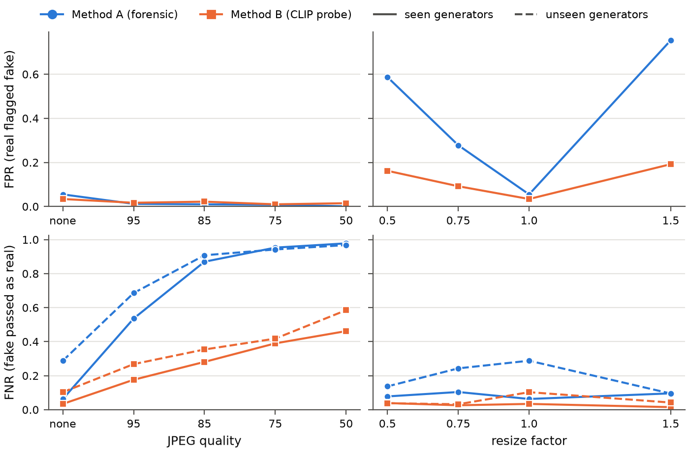

# Results log

Running log of experiments and findings. Every number here comes from a run in this repository;
the tables next to this file are exported from `runs/` with
`uv run python -m dorian_gray.experiments.export`. Label convention: 1 = fake (positive class).
FPR = real images flagged as fake, FNR = fake images passed as real. The decision threshold is
fixed at 0.5 and never tuned on test data.

| Folder | Content |
|---|---|
| `method_b/` | Method B, 5 split seeds: `summary.csv` (mean, std), `summary_per_seed.csv`, per seed `metrics.json`, `per_architecture.csv`, `per_format.csv` |
| `method_a/` | Method A, same layout as `method_b/`, plus `coefficients.csv` per seed |
| `method_a_<groups>/` | Method A trained on a subset of feature groups (ablation) |
| `robustness_a/` | Method A under JPEG recompression and resizing, same layout as `robustness_b/` |
| `robustness_b/` | Method B under JPEG recompression and resizing: `metrics.csv`, `flagged_by_format.csv` |
| `figures/` | `robustness.pdf` (for LaTeX), `robustness.png` |

---

## 1. Data (29. 10. 2026)

**Community Forensics** (Park & Owens, CVPR 2025), `OwensLab/CommunityForensics-Small`, CC BY-NC-SA.

- The "Small" repository is ~260 GB in 186 parquet shards (not 5.7 GB as the dataset viewer
  suggests). Each shard is one row group whose image column is a single uncompressed page, so a shard
  cannot be read partially: peak RAM is about the shard size (up to ~4.6 GB). We therefore built a
  metadata manifest of all shards (read remotely, metadata columns only) and downloaded 33 selected
  shards (31 GB).
- Seeded sample: 2,000 images per real shard, 1,000 per fake shard → **42,000 images**:

| | JPEG | PNG | Total |
|---|---|---|---|
| Real | 8,000 | 10,000 | 18,000 |
| Fake | 2,077 | 21,923 | 24,000 |

| Fake architecture | Images | Generators |
|---|---|---|
| GAN | 12,126 | 12 |
| Latent diffusion | 7,344 | 311 |
| Pixel diffusion | 2,453 | 3 |
| Other | 2,077 | 1 |

- **Split protocol** (`experiments/classify.py`): real images random 70/10/20 % (train/val/test);
  30 % of the fake *generators* are held out entirely ("unseen" test), the images of the remaining
  generators are split 70/10/20 % ("seen" test). Unseen results pair the held-out fakes with the
  same real test images, so FPR is identical in both test sets.
- The holdout is 30 % of generators *by count* (98 of 327). Since 311 generators are latent-diffusion
  fine-tunes, while GANs are few but large, the number of unseen images varies a lot between seeds
  (4,259 to 10,068), and so does the difficulty of the unseen set. Results are therefore reported as
  mean ± std over 5 seeds.

**Data caveats**
- File names repeat within a shard (different generators reuse names such as `00000152.png`); images
  are keyed by `(shard, row)`. Found by the 1:1 merge check; all 33 caches were verified name by name
  against the manifest.
- All 2,077 JPEG fakes come from **one generator (LFM)**. In the clean test, file format and
  generator are therefore confounded (see 2.3).

## 2. Method B: frozen CLIP ViT-L/14 + logistic regression (UnivFD-style)

Setup: open_clip `ViT-L-14/openai`, visual tower only, fp16 on a GTX 1050 (0.83 GB VRAM, ~7 img/s);
center crop 224 (no downscaling; upscale only below 224 px); 768-d embedding, L2-normalised;
logistic regression, C = 1, balanced class weights. Features cached once per shard.

### 2.1 Seen vs. unseen generators (5 seeds)

| Test set | Accuracy | FPR | FNR | AUC |
|---|---|---|---|---|
| Seen generators | 0.968 ± 0.005 | 0.030 ± 0.005 | 0.033 ± 0.007 | 0.996 ± 0.001 |
| Unseen generators | 0.923 ± 0.033 | 0.030 ± 0.005 | 0.105 ± 0.055 | 0.985 ± 0.008 |

Per seed, unseen FNR = 0.102, 0.028, 0.171, 0.082, 0.140 (seeds 0–4).

**Findings**
- On generators seen in training the probe is near-saturated (AUC 0.996). On unseen generators the
  miss rate triples on average, and its spread across seeds (0.028–0.171) is larger than its mean
  difference to the seen set. A single split would be misleading, so every result uses several seeds.
- FPR does not change between the two test sets (same real images), so generalisation failures show
  up only as missed fakes.

### 2.2 Detection rate of fakes per architecture (unseen generators)

| Architecture | Detected (range over seeds where present) |
|---|---|
| GAN | 0.849 – 0.982 |
| Latent diffusion | 0.783 – 0.960 |
| Pixel diffusion | 0.966 – 0.978 |
| Other (tamingTransformers) | 0.979 |

Unseen **latent-diffusion** generators are the weak spot. Worst single unseen generators (seed 0,
n ≥ 30): LFM 0.684 (JPEG), StyleGAN2-ADA 0.896, GigaGAN 0.917.

### 2.3 "JPEG = real" shortcut, clean test (seed 0)

| | JPEG | PNG |
|---|---|---|
| Real images flagged fake | 0.019 (n = 1,567) | 0.039 (n = 2,033) |
| Fake images detected | 0.684 (n = 2,077, all LFM) | 0.957 (n = 10,778) |

Consistent with the shortcut described by Grommelt et al. (`grommelt2024fake`), but on clean data it
cannot be separated from the generator (all JPEG fakes are LFM). Section 2.4 separates the two.

### 2.4 Robustness to JPEG recompression and resizing (seed 0)

Fixed subset of the test set: 1,000 real, 1,000 fakes of seen generators, 1,000 fakes of unseen
generators. Perturbations applied to real and fake images alike (Pillow; JPEG with 4:2:0 chroma
subsampling; bicubic, antialiased resize); the probe is trained on clean images only.

| Condition | FPR | FNR seen | FNR unseen | AUC seen | AUC unseen |
|---|---|---|---|---|---|
| clean | 0.034 | 0.034 | 0.103 | 0.995 | 0.984 |
| JPEG q95 | 0.017 | 0.176 | 0.268 | 0.977 | 0.967 |
| JPEG q85 | 0.022 | 0.281 | 0.354 | 0.959 | 0.946 |
| JPEG q75 | 0.010 | 0.390 | 0.418 | 0.952 | 0.945 |
| JPEG q50 | 0.015 | 0.462 | 0.585 | 0.933 | 0.905 |
| resize ×0.5 | 0.162 | 0.039 | 0.038 | 0.974 | 0.969 |
| resize ×0.75 | 0.092 | 0.026 | 0.032 | 0.991 | 0.987 |
| resize ×1.5 | 0.192 | 0.015 | 0.042 | 0.987 | 0.971 |

Rate of images flagged as fake, by group and *original* file format:

| Condition | Fake seen, PNG | Fake unseen, JPEG (LFM) | Fake unseen, PNG | Real JPEG | Real PNG |
|---|---|---|---|---|---|
| clean | 0.966 | 0.641 | 0.965 | 0.017 | 0.047 |
| JPEG q95 | 0.824 | 0.593 | 0.769 | 0.026 | 0.010 |
| JPEG q85 | 0.719 | 0.622 | 0.652 | 0.033 | 0.014 |
| JPEG q75 | 0.610 | 0.651 | 0.564 | 0.014 | 0.007 |
| JPEG q50 | 0.538 | 0.306 | 0.444 | 0.024 | 0.009 |
| resize ×0.5 | 0.961 | 1.000 | 0.952 | 0.162 | 0.162 |
| resize ×0.75 | 0.974 | 0.967 | 0.968 | 0.064 | 0.112 |
| resize ×1.5 | 0.985 | 0.856 | 0.985 | 0.124 | 0.241 |

**Findings**
- **JPEG pushes every score towards "real".** Even quality 95 raises the miss rate on seen generators
  5× (0.034 → 0.176); at q50 almost half of the fakes pass (0.462 seen, 0.585 unseen). FPR falls at
  the same time (0.034 → 0.010–0.022).
- **The format shortcut, separated from the generator:** fakes that were PNG lose detection steadily
  under recompression (seen 0.966 → 0.610 at q75), while the LFM fakes, already JPEG, are unaffected
  down to q75 (0.641 → 0.651) and only drop at q50. Real PNG images also become "more real" (flagged
  0.047 → 0.007 at q75). Recompression hurts exactly the images whose format it changes, which
  supports that the probe uses JPEG traces as evidence of authenticity.
- **Resizing has the opposite effect:** it barely affects fakes but makes real images look fake (FPR
  0.162 at ×0.5, 0.192 at ×1.5; 24 % of real PNGs at ×1.5). Interpolation traces are read as
  generator traces.
- **The ranking survives, the threshold does not:** AUC stays ≥ 0.905 under every condition, so most
  of the damage is a shift of the score distribution rather than lost information. This motivates
  (a) training with JPEG/resize augmentation, and (b) calibrating the probability on degraded
  validation images.

(Figure: see 3.5, A vs. B.)

## 3. Method A: hand-crafted forensic features + logistic regression

`methods/forensic.py`: 165 named features on a central crop (≤ 256 px, aligned to the 8×8 grid of the
original image, never resampled), in four groups: radial log power spectrum (25), periodic peaks of the
Laplacian residual at k/8 cycle/pixel (12), residual statistics, co-occurrences and inter-channel
correlation (63), 8×8 block-DCT energy and blockiness (65). Standardised logistic regression; the
per-image explanation is coefficient × standardised value per feature. Extraction ~40–46 img/s on CPU.

Same 42,000 images, same 5 split seeds and same threshold as Method B, so all differences are due to
the method.

### 3.1 Seen vs. unseen generators (5 seeds), A vs. B

| Method | Test set | Accuracy | FPR | FNR | AUC |
|---|---|---|---|---|---|
| A | Seen | 0.918 ± 0.027 | 0.083 ± 0.019 | 0.082 ± 0.034 | 0.971 ± 0.018 |
| A | Unseen | 0.777 ± 0.080 | 0.083 ± 0.019 | 0.304 ± 0.137 | 0.832 ± 0.117 |
| B | Seen | 0.968 ± 0.005 | 0.030 ± 0.005 | 0.033 ± 0.007 | 0.996 ± 0.001 |
| B | Unseen | 0.923 ± 0.033 | 0.030 ± 0.005 | 0.105 ± 0.055 | 0.985 ± 0.008 |

Per seed, Method A unseen FNR = 0.296, 0.179, 0.445, 0.159, 0.441 (seeds 0–4).

### 3.2 The unseen-generator gap is mostly one JPEG generator (LFM)

Method A's unseen results are bimodal: in seeds 0, 2, 4 unseen latent diffusion is detected at only
0.37–0.48, in seeds 1, 3 at 0.94. The difference is whether LFM, the only JPEG generator, is held out:

| Seed | LFM is in | A: LFM detected | B: LFM detected | A: other unseen LatDiff | B: other unseen LatDiff |
|---|---|---|---|---|---|
| 0 | unseen test | 0.039 | 0.684 | 0.949 | 0.953 |
| 1 | train (seen test) | 0.443 | 0.895 | 0.943 | 0.960 |
| 2 | unseen test | 0.029 | 0.689 | 0.949 | 0.960 |
| 3 | train (seen test) | 0.405 | 0.925 | 0.941 | 0.930 |
| 4 | unseen test | 0.025 | 0.731 | 0.951 | 0.950 |

Real images flagged as fake, by format (seed 0): A 0.009 JPEG / 0.108 PNG; B 0.019 JPEG / 0.039 PNG.

**Findings**
- Without LFM, both methods detect unseen latent-diffusion generators equally well (0.94–0.96).
  Method A's large unseen gap is almost entirely the **JPEG shortcut**: a held-out JPEG generator is
  detected at 2.5–3.9 %, i.e. Method A has learned "JPEG traces ⇒ real".
- Even with LFM in training, Method A detects only 0.41–0.44 of the LFM test images, and its FPR on
  real JPEGs rises to ~0.07: hand-crafted low-level statistics cannot separate a JPEG fake from a JPEG
  photo well. Method B is much less format-dependent (LFM 0.68–0.73 unseen, 0.90–0.93 seen; real FPR
  similar for both formats).
- Method A's FPR is format-dependent in the other direction too: real PNGs are flagged 0.108–0.137,
  real JPEGs ~0.01.

### 3.3 Feature-group ablation (5 seeds)

| Features | AUC seen | AUC unseen | FNR unseen | LFM detected (unseen seeds) | Real flagged JPEG / PNG |
|---|---|---|---|---|---|
| spectrum (25) | 0.824 ± 0.011 | 0.772 ± 0.017 | 0.404 ± 0.017 | | |
| periodic (12) | 0.643 ± 0.024 | 0.664 ± 0.060 | 0.378 ± 0.090 | | |
| residual (63) | 0.951 ± 0.023 | 0.858 ± 0.087 | 0.279 ± 0.143 | 0.067 | 0.042 / 0.160 |
| dct (65) | 0.905 ± 0.022 | 0.766 ± 0.083 | 0.392 ± 0.086 | | |
| all but dct (100) | 0.960 | 0.865 ± 0.086 | 0.280 | 0.046 | 0.037 / 0.137 |
| all (165) | 0.971 ± 0.018 | 0.832 ± 0.117 | 0.304 ± 0.137 | 0.031 | 0.034 / 0.121 |

(FPR per group, 5-seed mean: spectrum 0.219, periodic 0.399, residual 0.108, dct 0.167, all 0.083.
LFM and per-format columns are only computed for the three rows shown.)

**Findings**
- The **noise-residual** group carries most of the signal: alone it reaches AUC 0.951 seen / 0.858
  unseen, and on unseen generators it is no worse than all features combined.
- The DCT group fits the training generators (AUC 0.905 seen) but generalises poorly (0.766 unseen);
  removing it raises unseen AUC slightly (0.832 → 0.865, within the seed spread).
- Removing DCT does **not** remove the JPEG shortcut (LFM 0.031 → 0.046): compression changes the
  residual statistics too, so the shortcut cannot be fixed by feature selection. It has to be broken in
  the training data (JPEG augmentation of both classes, or JPEG fakes from several generators).
- The periodic-peak features are weak on this data (AUC 0.64). Expected for latent diffusion, whose
  decoder traces are less periodic than GAN upsampling; to be checked per architecture.

### 3.4 What the classifier uses (seed 0, all features)

Largest standardised coefficients (log-odds of "fake" per standard deviation; negative = evidence of
"real"): `res_kv3_logstd` −9.04, `cooc_kv3_-2_0` −3.91, `spec_r23` −3.78, `spec_r21` +3.26,
`cooc_kv3_2_-1` +3.24, `cooc_kv3_0_2` −3.06, `dct_56_logstd` +2.73, `dct_26_logstd` −2.69,
`rgb_corr_rb` −2.41. The dominant cue is the **energy of the high-pass noise residual** (more noise ⇒
real), consistent with generated images lacking sensor noise. Features are strongly correlated, so
individual coefficients (e.g. the opposite signs of neighbouring spectrum bins) should not be
over-interpreted; the per-image explanation should aggregate contributions per group.

### 3.5 Robustness to JPEG recompression and resizing, A vs. B (seed 0)

Same 3,000-image subset and perturbations as 2.4; both classifiers trained on clean images.

| Condition | A: FPR | A: FNR seen | A: FNR unseen | A: AUC seen / unseen | B: FPR | B: FNR seen | B: FNR unseen | B: AUC seen / unseen |
|---|---|---|---|---|---|---|---|---|
| clean | 0.055 | 0.063 | 0.288 | 0.988 / 0.853 | 0.034 | 0.034 | 0.103 | 0.995 / 0.984 |
| JPEG q95 | 0.012 | 0.536 | 0.686 | 0.901 / 0.786 | 0.017 | 0.176 | 0.268 | 0.977 / 0.967 |
| JPEG q85 | 0.010 | 0.870 | 0.908 | 0.708 / 0.669 | 0.022 | 0.281 | 0.354 | 0.959 / 0.946 |
| JPEG q75 | 0.008 | 0.953 | 0.942 | 0.559 / 0.606 | 0.010 | 0.390 | 0.418 | 0.952 / 0.945 |
| JPEG q50 | 0.001 | 0.978 | 0.968 | 0.595 / 0.588 | 0.015 | 0.462 | 0.585 | 0.933 / 0.905 |
| resize ×0.5 | 0.587 | 0.078 | 0.137 | 0.821 / 0.780 | 0.162 | 0.039 | 0.038 | 0.974 / 0.969 |
| resize ×0.75 | 0.278 | 0.104 | 0.243 | 0.906 / 0.815 | 0.092 | 0.026 | 0.032 | 0.991 / 0.987 |
| resize ×1.5 | 0.754 | 0.096 | 0.095 | 0.598 / 0.616 | 0.192 | 0.015 | 0.042 | 0.987 / 0.971 |

Method A, rate flagged as fake by group and original format: fake PNG (seen) 0.937 clean → 0.464 q95 →
0.047 q75; real PNG 0.081 clean → 0.007 q95; real JPEG 0.019 clean → 0.533 at ×0.5 and 0.967 at ×1.5.

**Findings**
- **Method A breaks down under JPEG.** Already at quality 95 it misses over half of the fakes
  (FNR 0.536 seen); from q85 on it calls almost everything real (FNR 0.87–0.98), and AUC falls to
  0.56–0.61 at q75–q50, i.e. close to chance. Unlike Method B (AUC ≥ 0.905 throughout), the
  information itself is destroyed, not just shifted: the hand-crafted features measure exactly the
  high-frequency content that JPEG quantisation removes.
- **Resizing makes Method A flag real images**: FPR 0.587 at ×0.5 and 0.754 at ×1.5 (B: 0.162, 0.192).
  Interpolation changes the residual and spectrum statistics the same way generation does; at ×1.5,
  96.7 % of real JPEGs are flagged (upscaling smooths away the noise that A uses as evidence of a camera).
- So, on clean images A is a reasonable, explainable detector for seen generators (AUC 0.988), but
  without augmentation it is not usable on images that were recompressed or rescaled, which is the
  normal case online. Method B degrades too, but it keeps its ranking ability.

### 3.6 Dataset bias found through Method A features

1,410 images have inter-channel residual correlation ≥ 0.999, i.e. they are effectively **grayscale**:
1,336 real, 74 fake. **7.4 % of real images but 0.3 % of fakes are grayscale**, so colour itself is a
"real" cue available to both methods. To be reported, and controlled (e.g. evaluate on colour images
only, or convert a share of fakes to grayscale in training). Three images have a constant colour
channel (correlation undefined, stored as 0).

**Design finding:** the SRM `kv3` kernel is separable, (2 − 2 cos ωx)(2 − 2 cos ωy)/4, so its frequency
response is zero on both frequency axes; peaks of purely horizontal or vertical periodic traces would
vanish. The periodic group therefore uses a Laplacian residual (2 cos ωx + 2 cos ωy − 4, non-zero
except at DC). Caught by a unit test with a synthetic period-4 pattern.

## 4. Open issues / next steps

- **Break the JPEG shortcut in training** (both methods): random JPEG recompression of real and fake
  training images, and/or JPEG fakes from several generators. Then re-measure LFM and the robustness grid.
- Control the grayscale bias (3.6).
- Train-time resize augmentation for Method B; calibration (reliability diagram, ECE).
- Tune C on the validation set (currently fixed at 1).
- Per-group aggregation of Method A's per-image explanation.
- Face swap (FF++ face crops) and local manipulation with localisation (CASIA / IMD2020 masks).
